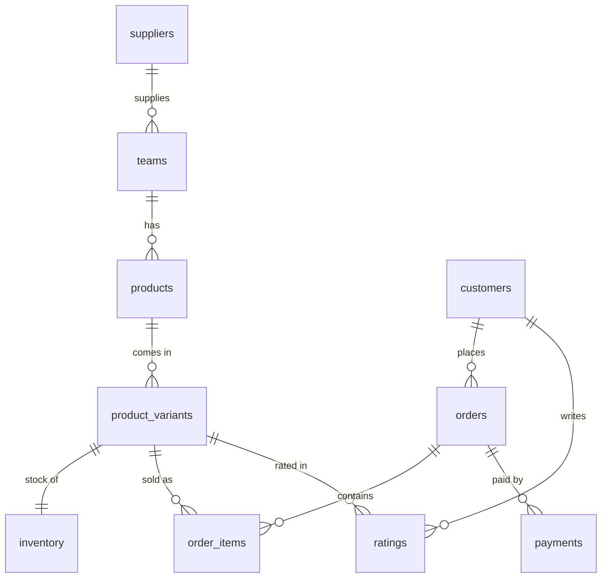

# ⚽ Shirts FC – Football Shirts Store Database

**Relational database in MySQL for an online football shirts store**: catalogue, stock, orders, payments, ratings, and automatic stock control and logging through triggers.

---

## 📌 Overview

The project models the data of an e-commerce store selling official football shirts. The whole database (schema, triggers, sample data, views and analytical queries) is contained in a single script, [`FULL_SCRIPT.sql`](FULL_SCRIPT.sql).

**What it covers**
- Product catalogue organised as *team → product (model/season) → variant (size/colour)*
- Stock management with a restock threshold for every variant
- Customers, orders, order lines and payments
- Customer ratings and comments
- Automatic stock update and audit log through triggers
- Invoice views and business queries (revenue, top customers, low stock, ratings)

## 🗂️ Database schema



| Table | Description |
|---|---|
| `suppliers` | Shirt suppliers (name, contact email, phone) |
| `teams` | Football clubs, each linked to one supplier |
| `products` | Base product: team, model (Home/Away/Third), season, base price, base SKU |
| `product_variants` | Sellable unit: unique SKU, size (`XS`–`XXL`), colour, price |
| `inventory` | Stock per variant (1:1), restock threshold, last restock date |
| `customers` | Customer details and address (unique email) |
| `orders` | Order header: date, status (`CREATED`, `PAID`, `SHIPPED`, `CANCELLED`, `REFUNDED`), shipping address, total |
| `order_items` | Order lines: quantity, unit price, `line_total` as a generated column |
| `payments` | Payments per order: amount, method (`CARD`, `PAYPAL`, `BANK_TRANSFER`, `CASH`), status (`SUCCESS`, `FAILED`, `PENDING`) |
| `ratings` | Rating from 1 to 5 with optional comment, per customer and variant |
| `logs` | Audit log filled by triggers |

**Integrity rules:** primary and foreign keys on every relation, `UNIQUE` on customer email, team name and SKU, `CHECK` constraints on `quantity > 0` and `rating BETWEEN 1 AND 5`, `ENUM` types for sizes, order status and payment method/status.

## ⚙️ Triggers

| Trigger | Event | Behaviour |
|---|---|---|
| `trg_after_insert_order_item` | `AFTER INSERT` on `order_items` | Locks the inventory row (`FOR UPDATE`), raises an error if the record is missing (`Inventory record not found`) or stock is insufficient (`Not enough stock`), otherwise decreases the stock |
| `trg_log_insert_order_item` | `AFTER INSERT` on `order_items` | Writes an entry in `logs` with order, variant and quantity |

## 👁️ Views

| View | Content |
|---|---|
| `view_invoice_head` | One row per order: customer, status, sub-total, amount paid, **balance due** |
| `view_invoice_details` | One row per order line: SKU, model, team, size, colour, quantity, unit price, line total |

## 📊 Analytical queries

The end of the script includes ready-to-run queries:

- **Best-selling product** by revenue
- **Monthly sales** (revenue and number of orders) for a given year
- **Top customer** by total spent
- **Low stock**: variants with `stock <= restock_threshold`
- **Average rating per team** with number of ratings
- **Audit log** ordered by most recent entry

## 🧪 Sample data

The script loads sample data covering **August 2023 – February 2025**: 6 suppliers, 12 clubs (Napoli, PSG, Manchester United, Real Madrid, Liverpool, Bayern Munich, Barcelona, Juventus, Chelsea, AC Milan, Borussia Dortmund, Atletico Madrid), 16 products for the 2023/24 and 2024/25 seasons with their size variants, 14 customers from several countries, plus orders, order lines, payments and ratings.

## ▶️ How to run

**Requirements:** MySQL 8.0.16 or later (needed for `CHECK` constraints to be enforced) and a client such as MySQL Workbench or the `mysql` CLI.

```bash
mysql -u root -p < FULL_SCRIPT.sql
```

Or open `FULL_SCRIPT.sql` in MySQL Workbench and run it entirely.

> ⚠️ The script starts with `DROP DATABASE IF EXISTS shirts_fc;`: if a database with this name already exists, it is **deleted and recreated**.

### Try the stock trigger

```sql
USE shirts_fc;

-- Check stock of variant 1
SELECT * FROM inventory WHERE variant_id = 1;

-- Try to order more than the available stock → fails with "Not enough stock"
INSERT INTO orders (customer_id) VALUES (1);
INSERT INTO order_items (order_id, variant_id, quantity, unit_price)
VALUES (LAST_INSERT_ID(), 1, 9999, 50.00);
```

## 📁 Repository structure

```
.
├── README.md
└── FULL_SCRIPT.sql    # schema, triggers, sample data, views, queries
```

## ⚠️ Limitations and possible improvements

- Stock is only decreased on insert: cancelled or refunded orders do **not** restock the items.
- `orders.total_amount` is filled by a one-off `UPDATE` after loading the data, not kept in sync by a trigger.
- There is no trigger for `UPDATE`/`DELETE` on `order_items`, so the log only tracks insertions.
- Prices are copied into `unit_price` on each order line (good for history), but nothing checks that they match `product_variants.price`.

## 🛠️ Tech stack

MySQL 8 · SQL (DDL, DML, triggers, views, generated columns)
